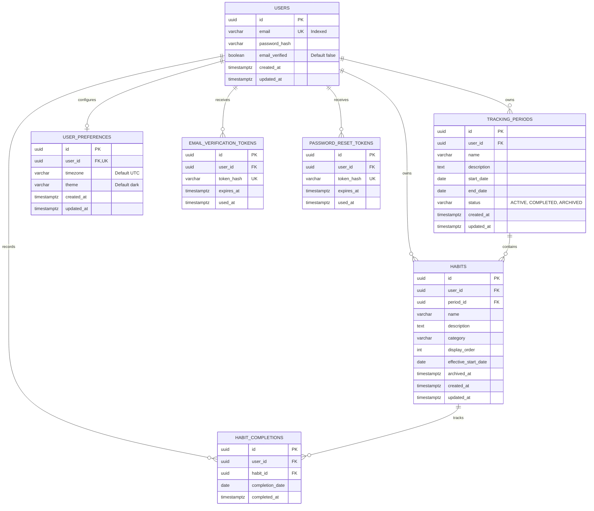
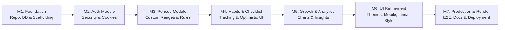

# LOCKIN — Technical Architecture & Implementation Specification

## 1. System Overview & Technology Stack

LOCKIN is a modern, minimalist, privacy-first personal habit-tracking and growth calendar application. Designed with an aesthetic inspired by Linear, Notion, and Apple Health, it empowers users to track custom periods, establish daily habits, and measure consistency over time without competitive distraction.

```
┌────────────────────────────────────────────────────────────────────────┐
│                          Client Application                            │
│           (React 18/19, TypeScript, Vite, Tailwind CSS, shadcn/ui)      │
│            Recharts, Framer Motion, TanStack Query, React Hook Form    │
└───────────────────────────────────┬────────────────────────────────────┘
                                    │ HTTPS / JSON / SameSite Cookie
                                    ▼
┌────────────────────────────────────────────────────────────────────────┐
│                        Spring Boot 3.3.x Backend                       │
│    Spring Security 6 (HTTP-only Session Cookies, BCrypt Password Hash)  │
│    Spring Data JPA / Hibernate, Jakarta Validation, Rate Limiting      │
│    Flyway Database Migration Engine, Global Exception Handler          │
└───────────────────────────────────┬────────────────────────────────────┘
                                    │ JDBC Connection Pool (HikariCP)
                                    ▼
┌────────────────────────────────────────────────────────────────────────┐
│                       PostgreSQL 14+ Relational DB                     │
│    UUID Primary Keys, Strict Foreign Keys, Date Range Constraints,     │
│    Partial Unique Indexes (1 active period per user, habit completion) │
└────────────────────────────────────────────────────────────────────────┘
```

### Stack Components

| Layer | Technology | Rationale |
| :--- | :--- | :--- |
| **Backend Framework** | Java 17 + Spring Boot 3.3.x | Robust enterprise architecture, strong typing, mature security ecosystem |
| **Security** | Spring Security 6 + BCrypt | HttpOnly `SameSite=Lax/Strict` cookies, CSRF protection, rate limiting |
| **Database & Migrations** | PostgreSQL 14+ with Flyway | UUID PKs, partial unique indexes, strict constraints, reproducible migrations |
| **Frontend Framework** | React 18+ with TypeScript & Vite | Ultra-fast build times, strict type safety, modular component structure |
| **Styling & Components** | Tailwind CSS + shadcn/ui (Radix) | Clean, accessible, Linear-style minimalist aesthetic with emerald accents |
| **Data Fetching & State** | TanStack Query v5 | Optimistic UI updates with rollback, server-state caching, automatic invalidation |
| **Visualizations** | Recharts & custom Heatmap grids | Responsive growth curve, dual count/percentage mode, heatmap intensity matrix |
| **Deployment Target** | Render (Static Site + Web Service + Managed PG) | Scalable, reproducible zero-downtime deployment via `render.yaml` |

---

## 2. Database ERD & Schema Design

All IDs use UUID (`gen_random_uuid()`). Audit timestamps are stored in UTC (`TIMESTAMP WITH TIME ZONE`). Daily completions and period bounds are stored as ISO calendar dates (`DATE`) to respect user timezones cleanly without time-shift bugs.

### Mermaid Entity-Relationship Diagram



### Table Definitions & Indexing Strategy

1. **`users`**
   - PK: `id UUID DEFAULT gen_random_uuid()`
   - `email VARCHAR(255) NOT NULL UNIQUE`
   - `password_hash VARCHAR(255) NOT NULL`
   - `email_verified BOOLEAN NOT NULL DEFAULT FALSE`
   - Index: `CREATE UNIQUE INDEX idx_users_email ON users(LOWER(email));`

2. **`email_verification_tokens` & `password_reset_tokens`**
   - PK: `id UUID DEFAULT gen_random_uuid()`
   - FK: `user_id UUID REFERENCES users(id) ON DELETE CASCADE`
   - Index: `CREATE INDEX idx_evt_token_hash ON email_verification_tokens(token_hash);`

3. **`user_preferences`**
   - PK: `id UUID DEFAULT gen_random_uuid()`
   - FK: `user_id UUID NOT NULL UNIQUE REFERENCES users(id) ON DELETE CASCADE`
   - `timezone VARCHAR(64) NOT NULL DEFAULT 'UTC'` (validated against IANA tz database)
   - `theme VARCHAR(16) NOT NULL DEFAULT 'dark'` ('dark', 'light', 'system')

4. **`tracking_periods`**
   - PK: `id UUID DEFAULT gen_random_uuid()`
   - FK: `user_id UUID NOT NULL REFERENCES users(id) ON DELETE CASCADE`
   - Constraints: `CHECK (start_date <= end_date)`
   - Status: `'ACTIVE'`, `'COMPLETED'`, `'ARCHIVED'`
   - **Crucial Rule**: Single active period per user enforced by partial unique index:
     ```sql
     CREATE UNIQUE INDEX idx_tracking_periods_user_active 
     ON tracking_periods(user_id) 
     WHERE status = 'ACTIVE';
     ```

5. **`habits`**
   - PK: `id UUID DEFAULT gen_random_uuid()`
   - FK: `period_id UUID NOT NULL REFERENCES tracking_periods(id) ON DELETE CASCADE`
   - FK: `user_id UUID NOT NULL REFERENCES users(id) ON DELETE CASCADE`
   - `effective_start_date DATE NOT NULL`
   - `archived_at TIMESTAMP WITH TIME ZONE NULL`
   - Index: `CREATE INDEX idx_habits_period_order ON habits(period_id, display_order);`

6. **`habit_completions`**
   - PK: `id UUID DEFAULT gen_random_uuid()`
   - FK: `user_id UUID NOT NULL REFERENCES users(id) ON DELETE CASCADE`
   - FK: `habit_id UUID NOT NULL REFERENCES habits(id) ON DELETE CASCADE`
   - `completion_date DATE NOT NULL`
   - **Crucial Rule**: Habit can only be completed once per day:
     ```sql
     CREATE UNIQUE INDEX idx_habit_completions_unique_day 
     ON habit_completions(habit_id, completion_date);
     CREATE INDEX idx_habit_completions_user_date 
     ON habit_completions(user_id, completion_date);
     ```

---

## 3. Backend Entities & Domain Business Rules

### Domain Models

- **`User`**: Core principal for authentication and resource ownership.
- **`TrackingPeriod`**: Encapsulates a distinct timeframe (e.g. 14, 21, 30, 90 days). Holds period-specific habit definitions. Historical periods are immutable (`status = COMPLETED`).
- **`Habit`**: Strictly daily habit in v1. Belongs to a period and user. Tracks `effective_start_date` so newly added habits do not retroactively penalize past dates.
- **`HabitCompletion`**: Immutable historical record indicating completion on a local `completion_date`.
- **`DailyProgressEngine`**: Pure domain service computing metrics on demand:
  $$\text{eligible\_count}(D) = |\{ h \in \text{habits} \mid h.\text{effective\_start\_date} \le D \land (h.\text{archived\_at} \text{ is null} \lor \text{date}(h.\text{archived\_at}) > D) \}|$$
  $$\text{completed\_count}(D) = |\{ c \in \text{completions} \mid c.\text{completion\_date} = D \land c.\text{habit} \in \text{eligible\_habits}(D) \}|$$
  $$\text{completion\_percentage}(D) = \begin{cases} \text{null} & \text{if } \text{eligible\_count}(D) = 0 \\ \frac{\text{completed\_count}(D)}{\text{eligible\_count}(D)} \times 100 & \text{if } \text{eligible\_count}(D) > 0 \end{cases}$$
- **Streak Calculation**:
  - Days outside period are ignored.
  - Days strictly in the future are ignored.
  - Historical days with $0\%$ completion break an active streak.

---

## 4. API Request & Response Contracts

Standardized JSON envelope for API responses and errors:

### Success Response Envelope
```json
{
  "success": true,
  "data": { ... },
  "message": null
}
```

### Error Response Envelope
```json
{
  "success": false,
  "error": {
    "code": "VALIDATION_FAILED | UNAUTHORIZED | NOT_FOUND | CONFLICT",
    "message": "Human readable error description",
    "details": [
      { "field": "email", "issue": "Must be a valid email format" }
    ]
  },
  "timestamp": "2026-11-16T12:00:00Z"
}
```

### Endpoint Inventory

#### Authentication (`/api/v1/auth`)
- `POST /register`: `{ email, password, confirmPassword }` $\rightarrow$ 201 Created (verification email sent)
- `POST /login`: `{ email, password }` $\rightarrow$ 200 OK (Sets HttpOnly session cookie)
- `POST /logout`: $\rightarrow$ 200 OK (Clears session cookie)
- `POST /verify-email`: `{ token }` $\rightarrow$ 200 OK
- `POST /resend-verification`: `{ email }` $\rightarrow$ 200 OK
- `POST /forgot-password`: `{ email }` $\rightarrow$ 200 OK (Generic message to prevent email enumeration)
- `POST /reset-password`: `{ token, newPassword, confirmNewPassword }` $\rightarrow$ 200 OK
- `GET /session`: $\rightarrow$ 200 OK `{ authenticated: true, user: { id, email, emailVerified } }`

#### User Profile & Preferences (`/api/v1/users/me`)
- `GET /`: $\rightarrow$ Returns user details and preferences (`timezone`, `theme`).
- `PATCH /`: Update preferences (`timezone`, `theme`) or password change (`oldPassword`, `newPassword`).
- `DELETE /`: Password confirmation required $\rightarrow$ wipes all records cascadingly.

#### Tracking Periods (`/api/v1/periods`)
- `GET /`: List all tracking periods for user (ordered by `start_date DESC`).
- `POST /`: Create new period: `{ name, description, startDate, endDate, habitNames: [] }`.
- `GET /active`: Return currently active tracking period or null.
- `GET /{periodId}`: Return period details with its habit configurations.
- `PATCH /{periodId}`: Update name or description (only if not completed).
- `POST /{periodId}/complete`: Manually mark period as completed.

#### Habits (`/api/v1/periods/{periodId}/habits` & `/api/v1/habits`)
- `GET /periods/{periodId}/habits`: List all active and archived habits for period.
- `POST /periods/{periodId}/habits`: Add habit: `{ name, description, category, displayOrder }`.
- `PUT /habits/{habitId}`: Update habit metadata (`name`, `description`, `category`, `displayOrder`).
- `PATCH /habits/{habitId}/archive`: Archive habit without destroying historical completions.

#### Daily Tracking (`/api/v1/tracking`)
- `GET /daily?date=YYYY-MM-DD`: Return checklist for date with completion states & daily stats.
- `PUT /{habitId}/{date}`: Check habit $\rightarrow$ persists completion idempotently, returns updated day stats.
- `DELETE /{habitId}/{date}`: Uncheck habit $\rightarrow$ deletes completion, returns updated day stats.
- `GET /history?periodId=UUID`: Return array of day records within the period range.

#### Analytics & Growth (`/api/v1/analytics/period/{periodId}`)
- `GET /overview`: Summary stats: total habits, possible completions, actual completions, overall percentage, average daily completion, current streak, longest streak, best-performing day, most consistent habit, least consistent habit.
- `GET /growth`: Time-series points for Recharts: `[{ date, eligibleCount, completedCount, percentage, isFuture }]`.
- `GET /habits`: Array of habit performance objects: total completions, eligible days, percentage, streaks, heatmap data.
- `GET /insights`: Derived data-backed insights list (e.g. "Your most consistent habit was Morning Run (92%)").

#### Calendar (`/api/v1/calendar`)
- `GET /month?periodId=UUID&year=YYYY&month=M`: Returns grid of days with completion intensity (0 to 4 levels), eligibility status, and future flag.
- `GET /day?periodId=UUID&date=YYYY-MM-DD`: Returns selected day's checklist & summary.

---

## 5. Frontend Architecture & Page Structure

### Directory Structure

```
lockin-web/
├── src/
│   ├── app/                 # Providers, router configuration, QueryClient
│   ├── components/          # Reusable UI primitives (Button, Card, Dialog, Badge, Input)
│   ├── layouts/             # AppLayout (Sidebar + Mobile Nav + Header), AuthLayout
│   ├── pages/               # Top-level route pages:
│   │   ├── auth/            # Login, Register, VerifyEmail, ForgotPassword, ResetPassword
│   │   ├── dashboard/       # Main Overview with checklist, quick stats, growth chart
│   │   ├── periods/         # Period management, creation modal, period history
│   │   ├── calendar/        # Monthly heatmap calendar view, historical day drilldown
│   │   ├── analytics/       # Period overview, habit rankings, comparative insights
│   │   └── settings/        # Preferences (timezone, theme), security, account deletion
│   ├── features/            # Feature-scoped business logic and UI subcomponents
│   │   ├── tracking/        # DailyChecklist, HabitItem, CompletionProgressRing
│   │   ├── charts/          # GrowthChart (count & % toggle), CalendarHeatmap
│   │   ├── periods/         # PeriodCard, PeriodPresetSelector, CreatePeriodModal
│   │   └── habits/          # HabitDialog, HabitReorderList
│   ├── hooks/               # Custom hooks (useSession, useActivePeriod, useDailyTracking)
│   ├── services/            # Axios / Fetch client with interceptors
│   ├── types/               # TypeScript interfaces matching backend DTOs
│   └── utils/               # Date helpers (date-fns or native), formatters, classnames
```

### UI Wireframes

#### Desktop Layout (Dashboard `/`)
```
┌──────────────────────────────────────────────────────────────────────────────────┐
│ [LOGO] LOCKIN        Period: [ Q4 Focus (Day 12 of 30) ▾ ]        [Profile] [🌙] │
├──────────────┬───────────────────────────────────────────────────────────────────┤
│ • Overview   │  TODAY — Monday, Nov 16, 2026                 [ 4 of 5 Done • 80% ]│
│ • My Periods │ ┌─────────────────────────────┐ ┌───────────────────────────────┐ │
│ • Calendar   │ │ DAILY CHECKLIST             │ │ QUICK STATS                   │ │
│ • Analytics  │ │ [x] Morning Meditation      │ │ • Period Progress: 40% (12/30)│ │
│ • Settings   │ │ [x] Read 20 Pages           │ │ • Current Streak: 8 Days      │ │
│              │ │ [x] 45 Min Workout          │ │ • Overall Rate: 84%           │ │
│              │ │ [x] Deep Work (2h)          │ │ • Best Habit: Meditation      │ │
│              │ │ [ ] Journal Reflection      │ └───────────────────────────────┘ │
│              │ │ [+ Add Daily Habit]         │                                   │
│              │ └─────────────────────────────┘                                   │
│              │ ┌───────────────────────────────────────────────────────────────┐ │
│              │ │ GROWTH TRAJECTORY                  [Mode: Count | Percentage] │ │
│              │ │   5 |                  ╭───╮                                  │ │
│              │ │   4 |      ╭───╮   ╭───╯   │   ╭───●                          │ │
│              │ │   3 |  ╭───╯   │   │       ╰───╯                              │ │
│              │ │   0 └──┴───────┴───┴─────────────────────────────── (Nov 30)  │ │
│              │ └───────────────────────────────────────────────────────────────┘ │
└──────────────┴───────────────────────────────────────────────────────────────────┘
```

#### Mobile Layout
```
┌──────────────────────────┐
│ LOCKIN            [🌙]   │
│ Period: Q4 Focus (12/30) │
├──────────────────────────┤
│ Today • Mon, Nov 16      │
│ [==== 80% Completed ===] │
├──────────────────────────┤
│ CHECKLIST                │
│ [x] Morning Meditation   │
│ [x] Read 20 Pages        │
│ [x] 45 Min Workout       │
│ [x] Deep Work (2h)       │
│ [ ] Journal Reflection   │
│ [+ Add Habit]            │
├──────────────────────────┤
│ GROWTH CHART             │
│ [ ~~~~~~/\~●          ]  │
├──────────────────────────┤
│ [Home] [Periods] [Cal] [⚙]│
└──────────────────────────┘
```

---

## 6. Implementation Milestones & Verification Gates



### Milestone Breakdown

1. **Milestone 1 — Foundation & Architecture**
   - Initialize Git repository structure (`lockin/` monorepo with `server/` and `web/`).
   - Setup Maven Spring Boot 3.3 project with PostgreSQL driver and Flyway.
   - Setup React + Vite + TypeScript + Tailwind CSS project with shadcn/ui.
   - Configure Flyway migration `V1__init_schema.sql` implementing the full database schema.
   - Setup local Docker Compose and verify PostgreSQL connection.

2. **Milestone 2 — Authentication Module**
   - Implement User entity, repository, and token management.
   - Configure Spring Security with BCrypt password hashing, CORS, and HttpOnly session cookies.
   - Build Registration, Email Verification (with mockable mail sender), Login, Logout, and Password Reset endpoints.
   - Build frontend authentication forms with React Hook Form + Zod and TanStack Query.
   - Execute backend auth and authorization unit & integration tests.

3. **Milestone 3 — Tracking Period Module**
   - Implement TrackingPeriod domain model, repository, and service.
   - Enforce 1 active period rule, date range validation (`start_date <= end_date`), presets (7, 14, 21, 30, 60, 90 days, custom).
   - Build Period CRUD endpoints and frontend period selector & creation wizard with live preview.
   - Validate immutable audit trail for completed periods.

4. **Milestone 4 — Habit Management & Daily Checklist Module**
   - Implement Habit & HabitCompletion domain models.
   - Implement DailyProgressEngine for date eligibility and completion percentage calculation.
   - Build daily checklist endpoints with optimistic locking and duplicate completion prevention.
   - Build frontend DailyChecklist with instant optimistic UI toggle and error rollback.
   - Verify historical date boundaries and habit effective date rules.

5. **Milestone 5 — Growth Charts, Analytics & Calendar Modules**
   - Build time-series growth aggregator with Dual Mode (Count vs. Percentage).
   - Build Recharts growth chart with interactive tooltips and dynamic eligible scaling.
   - Build monthly Calendar heatmap with intensity shading (0-4), future date distinction, and date drilldown.
   - Implement habit streaks (current & longest) and data-backed text insights.

6. **Milestone 6 — UI Refinement, Responsive Design & Theming**
   - Implement dark/light theme switching with smooth transitions.
   - Refine desktop sidebar and mobile navigation bar for touch ergonomics.
   - Add Framer Motion micro-interactions on checklist toggle and card transitions.
   - Complete required UI empty states, loading skeletons, and error boundary fallbacks.

7. **Milestone 7 — Testing, Production Hardening & Render Deployment**
   - Run end-to-end integration tests (data isolation between users, timezone boundaries).
   - Author `render.yaml` Blueprint for Render deployment (PostgreSQL + Spring Boot JAR + Static Site).
   - Author project documentation: `README.md`, `LICENSE` (MIT), `CONTRIBUTING.md`, `CODE_OF_CONDUCT.md`, `.env.example`.
